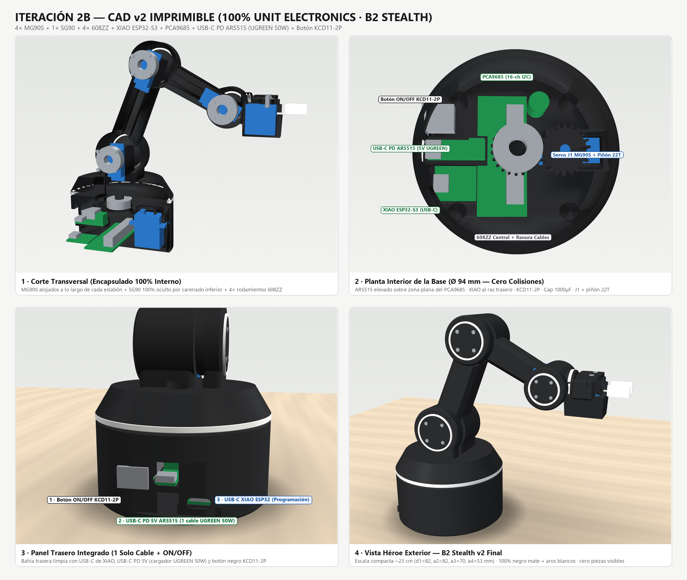
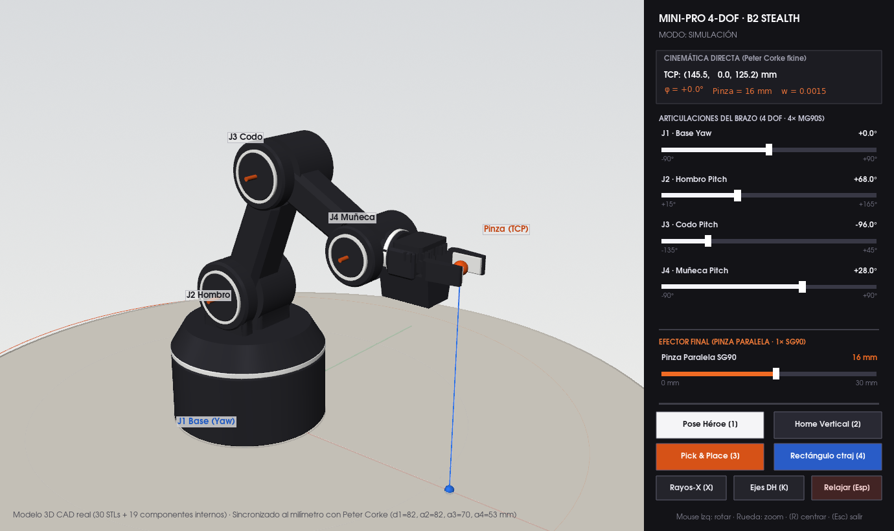
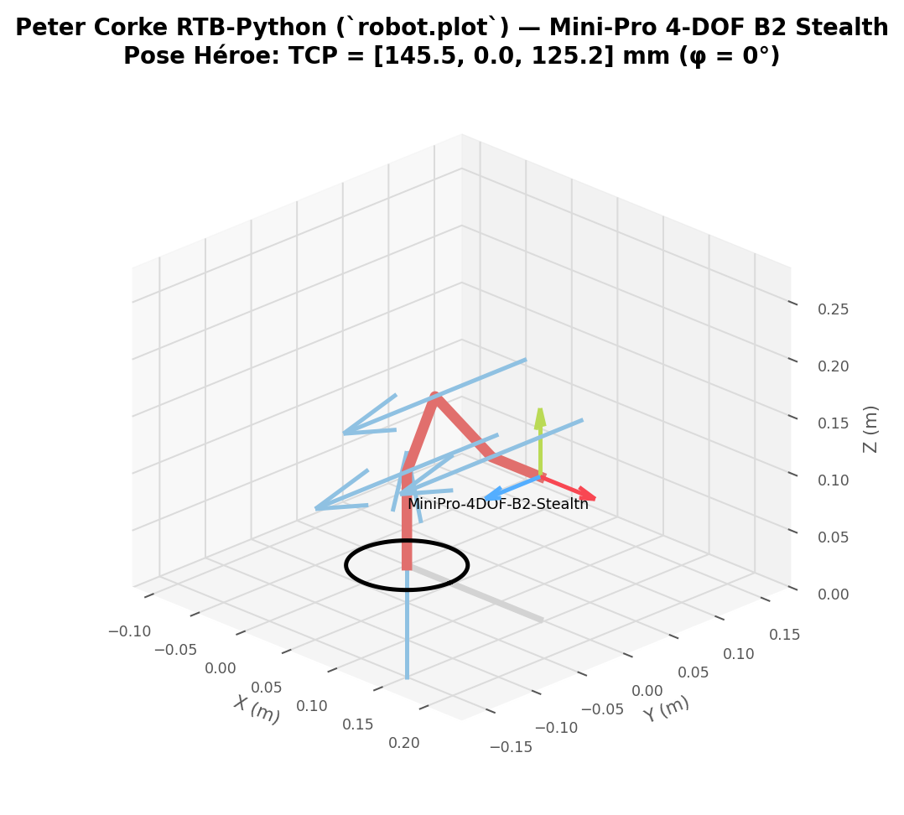
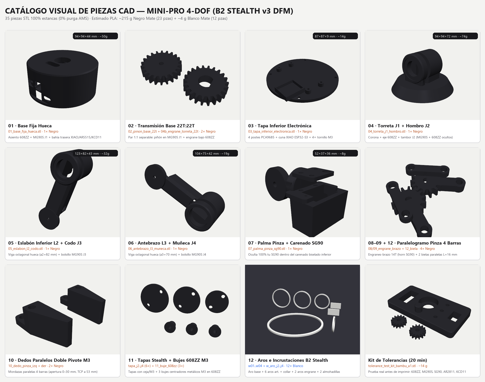
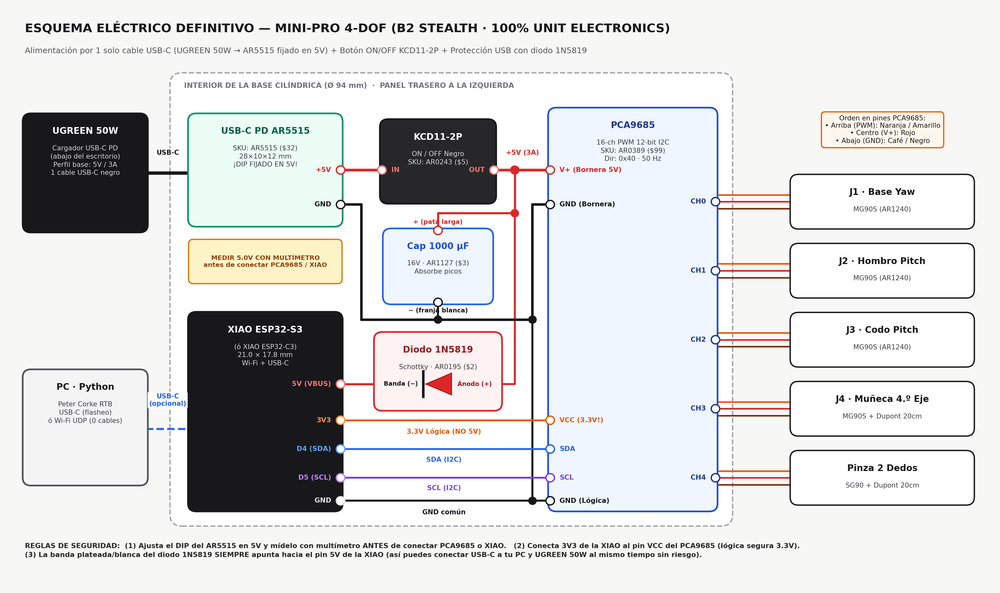

# Mini-Pro 4-DOF Desktop Robot Arm (`B2 Stealth`)

[](LICENSE)
[](#cinemática-peter-corke-y-gemelo-digital)
[](#cad-paramétrico-y-catálogo-de-piezas)
[](#electrónica-y-firmware-xiao-esp32-s3)

Brazo robótico de escritorio **4-DOF + pinza paralela de 2 dedos** con estética minimalista monocromática **`B2 Stealth`**, diseñado desde cero mediante **CAD paramétrico por código (`CadQuery`)**, modelado cinemático exacto con la **Robotics Toolbox de Peter Corke (`roboticstoolbox-python`)**, **gemelo digital en tiempo real por Wi-Fi UDP / USB Serial** y alimentación limpia con **un único cable USB-C PD** (5V / 3A).

> **Single Source of Truth:** Un solo archivo ([`cad/params.py`](cad/params.py)) controla al milímetro las dimensiones Denavit-Hartenberg, el ensamblaje 3D en SolidWorks/STEP, los 30 STLs imprimibles, la simulación de Peter Corke y los límites articulares del firmware.



---

## Características Principales

* **4 Grados de Libertad + Pinza Paralela:** Base Yaw (`J1`), Hombro Pitch (`J2`), Codo Pitch (`J3`), Muñeca Pitch (`J4`, permite mantener la orientación $\varphi$ de la pinza constante durante *pick-and-place*) y pinza paralela de 2 dedos (`0–30 mm`).
* **100% Cables y Servos Ocultos:** Los `4× MG90S` metálicos (compatibles en huella con `MG92B`), el `SG90` de la pinza, `4×` rodamientos `608ZZ`, el driver `PCA9685` y la `XIAO ESP32-S3` van encapsulados dentro de los tambores, vigas huecas octagonales y la base Ø 94 mm.
* **Alimentación con 1 Solo Cable USB-C:** Cargador USB-C PD estándar (ej. UGREEN 50W) → módulo PD Trigger `AR5515` fijado en **5V** → botón físico trasero `KCD11-2P` → filtro `1000 µF` + diodo Schottky antirretorno `1N5819` para la `XIAO ESP32-S3`.
* **Diseño Bicolor sin Desperdicio (0% Purga AMS):** 30 piezas `.STL` auditadas **30/30 estancas (*watertight*)** separadas por filamento (**18 Negro Mate ≈ 220 g** + **12 Blanco Mate ≈ 4 g**, total **~224 g de PLA**).
* **Control Triple Simultáneo:**
  1. **Peter Corke Python por Wi-Fi UDP (puerto `4210`)** — gemelo digital en vivo manteniendo 1 solo cable de corriente en el escritorio.
  2. **USB Serial (`115200 baud`)** — compatible con Python y scripts de respaldo en MATLAB.
  3. **Web UI Minimalista `B2 Stealth`** — servida directamente desde la `XIAO ESP32-S3` (`http://192.168.4.1/` o IP local) sin necesidad de PC.

---

## Parámetros Denavit-Hartenberg (Estándar)

| Articulación | $\theta_i$ | $d_i$ (mm) | $a_i$ (mm) | $\alpha_i$ (rad) | Rango Físico | Actuador |
| :---: | :---: | :---: | :---: | :---: | :---: | :---: |
| **J1 · Base Yaw** | $q_1$ | `82.0` | `0.0` | $+\pi/2$ | $[-90^\circ,\ +90^\circ]$ | `MG90S` (`CH0`) + `22T:22T` |
| **J2 · Hombro Pitch** | $q_2$ | `0.0` | `82.0` | `0` | $[+15^\circ,\ +165^\circ]$ | `MG90S` (`CH1`) + `608ZZ` |
| **J3 · Codo Pitch** | $q_3$ | `0.0` | `70.0` | `0` | $[-135^\circ,\ +45^\circ]$ | `MG90S` (`CH2`) + `608ZZ` |
| **J4 · Muñeca Pitch** | $q_4$ | `0.0` | `53.0` | `0` | $[-90^\circ,\ +90^\circ]$ | `MG90S` (`CH3`) + `608ZZ` |
| **Pinza Paralela** | — | — | — | — | `0 – 30 mm` | `SG90` (`CH4`) + `14T:14T` |

* **Alcance horizontal máximo:** `205 mm` (`a₂ + a₃ + a₄`) · **Precisión analítica FK ↔ IK:** `1.27 × 10⁻¹⁴ °` · **Error Z en trayectoria cartesiana `ctraj`:** `6.39 × 10⁻¹⁴ mm`.

---

## Cinemática Peter Corke y Gemelo Digital 3D Real



| Modelo 3D Nativo (`roboticstoolbox-python`) | Espacio de Trabajo y Proyecciones XY / XZ / YZ |
| :---: | :---: |
|  |  |

```powershell
# Instalar dependencias
pip install -r requirements.txt

# 1) Ejecutar demostración completa Peter Corke (FK/IK, Workspace XY/XZ/YZ, jtraj, ctraj y manipulabilidad)
python python/demo_peter_corke.py

# 2) Abrir Gemelo Digital Interactivo 3D (modo simulación, Wi-Fi UDP o USB Serial)
python python/gemelo_digital_esp32.py                     # Simulación (DRY_RUN)
python python/gemelo_digital_esp32.py --wifi 192.168.4.1  # Vivo por Wi-Fi UDP (1 solo cable)
python python/gemelo_digital_esp32.py --port COM5         # Vivo por USB Serial
```

> También se incluyen scripts equivalentes de respaldo para **MATLAB + Robotics Toolbox** en [`matlab/`](matlab/).

---

## CAD Paramétrico y Catálogo de Piezas



* **Ensamble CAD Editable (SolidWorks / Fusion 360 / FreeCAD / Bambu Studio):** [`cad/exports/mini_pro_b2_stealth_v2.step`](cad/exports/mini_pro_b2_stealth_v2.step) (con las 30 piezas y todos los componentes internos nombrados en el árbol).
* **Piezas `.STL` separadas por color:** [`cad/exports/stl_negro_mate/`](cad/exports/stl_negro_mate/) (18 pzas) y [`cad/exports/stl_blanco_mate/`](cad/exports/stl_blanco_mate/) (12 pzas).
* **Kit de Calibración de Tolerancias (20 min / ~14 g):** [`cad/exports/tolerance_test_kit_bambu_a1.stl`](cad/exports/tolerance_test_kit_bambu_a1.stl) para validar ajustes de `608ZZ`, `MG90S`, `SG90`, insertos `M3` y botón `KCD11-2P` antes de imprimir el brazo completo.
* **Visor 3D Interactivo incluido:**
  ```powershell
  python cad/visor_cad_interactivo.py
  ```
  *(Controles: **`E`** explosionar · **`X`** Rayos-X · **`H`** electrónica/servos internos · **`←/→`** pieza por pieza · **Clic Derecho** identificar en 3D · **`1..5`** subensambles).*

---

## Electrónica y Firmware `XIAO ESP32-S3`



* **Guía pin-a-pin y protocolo de encendido seguro:** [`electronics/DIAGRAMA_CABLEADO.md`](electronics/DIAGRAMA_CABLEADO.md)
* **Lista de materiales (BOM verificada en México):** [`docs/BOM_UNIT_ELECTRONICS.md`](docs/BOM_UNIT_ELECTRONICS.md) *(presupuesto total estimado con filamento: ~1,155 – 1,355 MXN)*.
* **Firmware `XIAO ESP32-S3 / C3`:** [`firmware/minipro_b2_stealth/`](firmware/minipro_b2_stealth/) + guía rápida en [`firmware/README_FIRMWARE.md`](firmware/README_FIRMWARE.md).
  * Interpolador **quíntico mínimo-jerk a `100 Hz`** ($10u^3 - 15u^4 + 6u^5$, idéntico a `rtb.jtraj`).
  * Comandos ASCII unificados (Serial / UDP): `G`, `M`, `CENTER`, `HERO`, `HOME`, `DEMO`, `RAW`, `RELAX`, `STATUS`.
  * Arranque seguro en modo `RELAX` (evita golpes mecánicos antes de calibrar) y comando `CENTER` (`1500 µs` en `CH0..CH3`) para atornillar los *horns* a 90° exactos.

> **Advertencia de seguridad en banco:** Antes de conectar el `PCA9685` y la `XIAO`, fija los micro-switches DIP del módulo USB-C PD `AR5515` en **5V** y **verifica `4.95 – 5.15 V` con multímetro**. Conecta siempre `PCA9685 VCC` a **`XIAO 3V3`** (nunca a `5V`) y orienta la banda del diodo `1N5819` hacia el pin `5V` de la `XIAO`.

---

## Estructura del Repositorio

```text
minipro-4dof-robot-arm/
├── cad/
│   ├── params.py                          # Single Source of Truth (DH + hardware + holguras)
│   ├── mini_pro_b2_stealth_v2.py          # Generador CAD paramétrico CadQuery (STEP + 30 STLs)
│   ├── tolerance_test_kit.py              # Kit de prueba de tolerancias (20 min)
│   ├── visor_cad_interactivo.py           # Visor 3D interactivo VTK (explode, X-Ray, picking)
│   ├── render_iter2b_vtk.py               # Generador de tablero 4 vistas VTK
│   ├── generar_catalogo_piezas.py         # Generador del catálogo visual de 30 STLs
│   └── exports/
│       ├── mini_pro_b2_stealth_v2.step    # Ensamble completo para SolidWorks / Fusion / Bambu Studio
│       ├── tolerance_test_kit_bambu_a1.stl
│       ├── stl_negro_mate/                # 18 piezas PLA Negro Mate (watertight)
│       ├── stl_blanco_mate/               # 12 piezas PLA Blanco Mate (watertight)
│       └── hardware_ref/                  # 19 mallas de referencia (servos, PCBs, 608ZZ)
├── python/
│   ├── robot_minipro_rtb.py               # Modelo oficial Peter Corke DHRobot + IK analítica 4R
│   ├── demo_peter_corke.py                # Validación cinemática + exportación de gráficas
│   └── gemelo_digital_esp32.py            # Gemelo digital interactivo (DRY_RUN / Wi-Fi UDP / Serial)
├── firmware/
│   ├── minipro_b2_stealth/                # Sketch Arduino / PlatformIO (100 Hz + Web UI + UDP)
│   ├── platformio.ini
│   └── README_FIRMWARE.md
├── electronics/
│   ├── DIAGRAMA_CABLEADO.md               # Tabla pin-a-pin + checklist de seguridad
│   ├── esquema_cableado_b2_stealth.png
│   └── generar_esquema.py
├── docs/
│   ├── BOM_UNIT_ELECTRONICS.md            # Carrito verificado en México con SKUs y precios
│   ├── RUTA_PROYECTO.md                   # Mapa de iteraciones y estado actual
│   ├── graficas_peter_corke/              # Figuras de validación cinemática
│   └── renders/                           # Renders CAD y catálogo de piezas
├── matlab/                                # Scripts equivalentes de respaldo para MATLAB RTB
├── requirements.txt
└── LICENSE
```

---

## Licencia

Distribuido bajo licencia **MIT**. Consulta [`LICENSE`](LICENSE) para más detalles.
