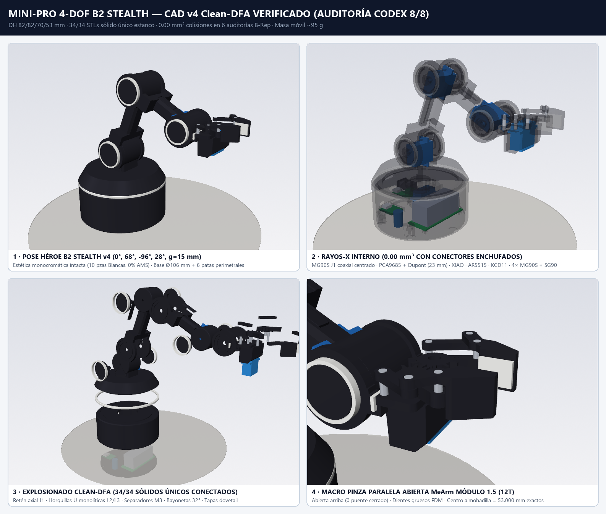
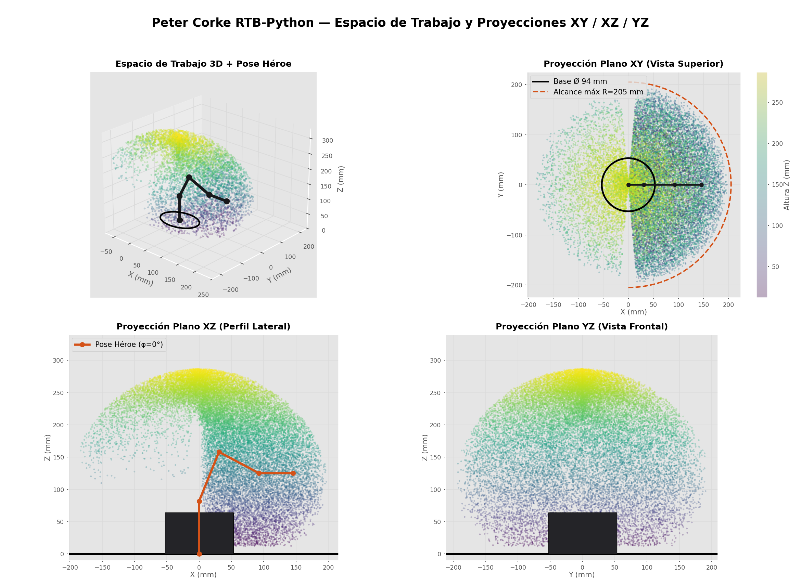
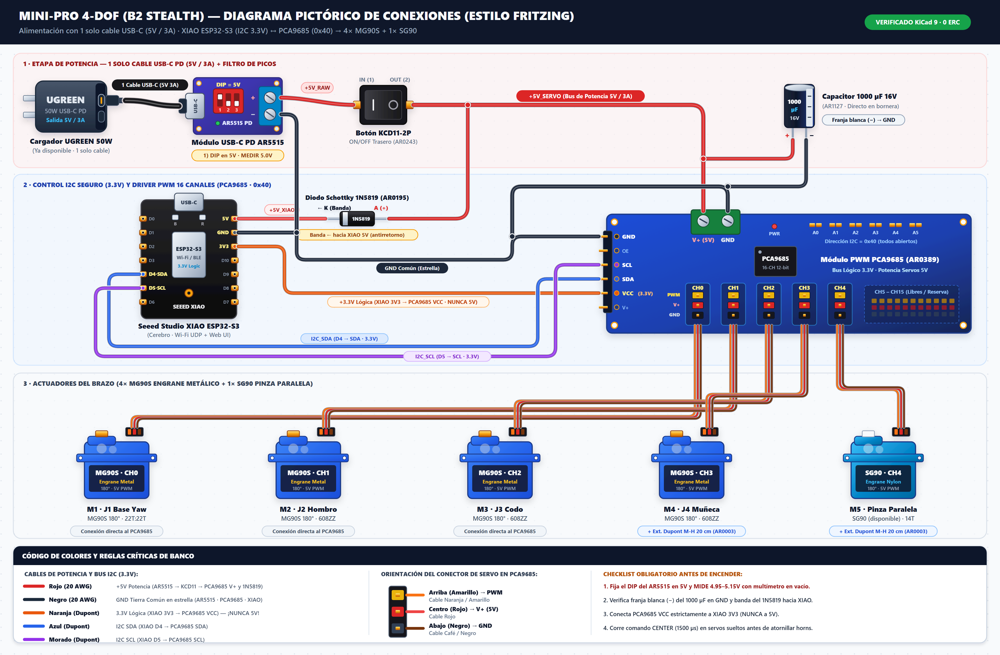

# Mini-Pro 4-DOF Desktop Robot Arm (`B2 Stealth` · `CAD v4 Clean-DFA`)

[](LICENSE)
[](#cinemática-peter-corke-y-gemelo-digital-3d-real)
[](#cad-paramétrico-y-placas-bambu-lab-a1-v4-clean-dfa)
[](#electrónica-simulación-spicewokwi-y-firmware)
[](#electrónica-simulación-spicewokwi-y-firmware)

Brazo robótico de escritorio **4-DOF + pinza paralela abierta MeArm módulo `1.5`** con estética industrial minimalista **`B2 Stealth`**, diseñado desde cero en **CAD paramétrico (`CadQuery`)**, auditado matemáticamente por **intersección B-Rep 3D multipose (`0.00 mm³` colisiones en las 6 auditorías)** y **100% sólido único conectado (`34/34` STLs `len(split()) == 1`)**, modelado cinemático exacto con **Peter Corke (`roboticstoolbox-python`)**, **esquemático nativo KiCad 9.0 (`0 Errores ERC`)**, **simulación SPICE real (`ngspice` con modelo OCP `3.0 A`)**, **simulador Wokwi**, **gemelo digital 3D en tiempo real (Wi-Fi UDP / USB Serial)** y alimentación con **un único cable USB-C PD** (`5V / 3A`).

> **Single Source of Truth:** Un solo archivo ([`cad/params.py`](cad/params.py)) sincroniza al milímetro la cinemática DH (`82 / 82 / 70 / 53 mm`), el ensamble 3D `v4 Clean-DFA`, la cinemática trigonométrica exacta de la pinza paralela, la guarda anti-mesa (`Z_tcp ≥ 8 mm`), Peter Corke, el Gemelo Digital y el firmware `XIAO ESP32-S3`.



---

## Arquitectura `CAD v4 Clean-DFA` (Auditoría Cruzada 8/8 Resuelta)

* **34 / 34 Piezas Estancas y de Un Solo Sólido Conectado (`len(split()) == 1`):** Horquillas en U monolíticas (`05_eslabon_l2_v4`, `06_antebrazo_l3_v4`, `07_palma_pinza_v4`), canales traseros de cables con **tapas deslizables en cola de milano (`dovetail`)** y **masa móvil reducida a ~95 g** (`49.3 g` PLA).
* **0.00 mm³ Colisiones B-Rep en 6 Escenarios:** Pose héroe completa (`56` sólidos incluyendo conectores Dupont enchufados de `23 mm`, terminales `KCD11` y servos), extremo crítico **`J2=68°, J3=-135°, J4=28°`**, extremo opuesto **`J2=150°, J3=+45°, J4=+90°`**, plegado compacto **`J2=45°, J3=-135°, J4=-90°`**, y pinza en **`g = 2 mm`** y **`g = 28 mm`**.
* **Base Coaxial `Ø 106 mm` + Retención Axial Independiente:** `MG90S J1` centrado bajo la torreta (elimina engranaje de base), pista anular amplia `Ø 88 mm`, **retén axial `04b_reten_axial_j1`** (`3× M3`) que libera completamente al *horn* de cargas axiales, **6 patas antideslizantes en el perímetro (`r = 45.5 mm`)**, aro de lastre interno y `PCA9685` / `XIAO` / `AR5515` / `KCD11` / `1000 µF` con `0.00 mm³` de interferencia.
* **Articulaciones `J2 / J3 / J4` Sin Cautín ni Clips Frágiles:**
  * Acceso directo con desarmador (`Ø 5.2 mm`) al tornillo central del *horn* + acceso abierto `+Y` a las orejas `M2` del `MG90S`.
  * Pivote pasivo con **casquillo separador escalonado liso (`11_separador_m3_*`)** y tuerca **`M3 Nyloc` cautiva**: la rosca M3 nunca roza el plástico y la Nyloc nunca frena el giro (`0.35 mm` luz axial garantizada).
  * **Tapas Stealth de cierre por BAYONETA (`32°`)**: cero flexión en PLA Mate + 6 aros blancos separados (`0%` purga AMS).
* **Pinza Paralela Abierta MeArm Módulo `1.5` (`12T`):** Abierta arriba (0 puente cerrado), dientes gruesos FDM con `0.35 mm` backlash, engrane+brazo+horn en 1 solo sólido rígido, centro de almohadillas calibrado exacto en **`X = a4 = 53.000 mm`** en `g = 15 mm`, y **ecuación trigonométrica exacta (`asin/cos`)** compartida entre CAD, Python y Firmware.
* **Alimentación 1 Solo Cable USB-C + Seguridad de Firmware:**
  * Cargador **UGREEN 50W** → `AR5515` (`DIP = 5V`) → `KCD11-2P` → `1000 µF` (`AR1127`) + Schottky `1N5819` → `XIAO ESP32-S3` ↔ I2C **`3.3V`** ↔ `PCA9685`.
  * Firmware `100 Hz` quíntico mínimo-jerk con **`FULL_OFF` real (`4096`)** desde `setup()`, resincronización limpia tras `CENTER`/`RAW`, rampa suave obligatoria (`≥ 1200 ms`) al salir de `RELAX` y **guarda cinemática anti-mesa** (`Z_j3/j4 ≥ 22 mm`, `Z_tcp ≥ 8 mm`).

---

## Parámetros Denavit-Hartenberg (Estándar 4R Serial)

| Articulación | $\theta_i$ | $d_i$ (mm) | $a_i$ (mm) | $\alpha_i$ (rad) | Rango Físico | Actuador / Mecanismo `v4` |
| :---: | :---: | :---: | :---: | :---: | :---: | :---: |
| **J1 · Base Yaw** | $q_1$ | `82.0` | `0.0` | $+\pi/2$ | $[-90^\circ,\ +90^\circ]$ | `MG90S` coaxial + pista `Ø88` + retén axial |
| **J2 · Hombro Pitch** | $q_2$ | `0.0` | `82.0` | `0` | $[+15^\circ,\ +165^\circ]$ | `MG90S` *(huella `MG92B`)* + separador M3 |
| **J3 · Codo Pitch** | $q_3$ | `0.0` | `70.0` | `0` | $[-135^\circ,\ +45^\circ]$ | `MG90S` + separador M3 + Nyloc cautiva |
| **J4 · Muñeca Pitch** | $q_4$ | `0.0` | `53.0` | `0` | $[-90^\circ,\ +90^\circ]$ | `MG90S` + separador M3 + bayoneta 32° |
| **Pinza Paralela** | — | — | — | — | `0 – 30 mm` | `SG90` + MeArm abierto `12T` mod `1.5` |

* **Alcance horizontal máximo:** `205 mm` · **Error FK ↔ IK:** `1.27 × 10⁻¹⁴ °` · **Error Z `ctraj`:** `6.39 × 10⁻¹⁴ mm` · **Centro almohadillas @ `g=15 mm`:** `53.000 mm` (`err = 0.0000 mm`).

---

## Cinemática Peter Corke y Gemelo Digital 3D Real


| Modelo 3D Nativo (`roboticstoolbox-python`) | Espacio de Trabajo y Proyecciones XY / XZ / YZ |
| :---: | :---: |
|  |  |

```powershell
pip install -r requirements.txt

# 1) Validación completa Peter Corke (FK/IK, Workspace, jtraj, ctraj y manipulabilidad)
python python/demo_peter_corke.py

# 2) Gemelo Digital 3D Real v4 (DRY_RUN, Wi-Fi UDP 1-cable o USB Serial)
python python/gemelo_digital_esp32.py                     # Simulación 3D
python python/gemelo_digital_esp32.py --wifi 192.168.4.1  # Vivo por Wi-Fi UDP
python python/gemelo_digital_esp32.py --port COM5         # Vivo por USB Serial
```

---

## CAD Paramétrico y Placas Bambu Lab A1 (`v4 Clean-DFA`)


* **Ensamble Editable STEP (`v4 Clean-DFA`):** [`cad/exports/v4_clean_dfa/mini_pro_b2_stealth_v4.step`](cad/exports/v4_clean_dfa/mini_pro_b2_stealth_v4.step)
* **Kit Progresivo de Prototipado (imprimir ANTES del brazo completo):** [`cad/exports/v4_clean_dfa/cupones_prueba/`](cad/exports/v4_clean_dfa/cupones_prueba/)
  1. `cupon_1_ajustes_pivote_bayoneta.3mf` — Valida ajuste `MG90S`, tuercas `M3`/Nyloc cautivas, bayoneta `32°` (10 ciclos), separador `M3` y cola de milano.
  2. `cupon_2_articulacion_piloto_j2.3mf` — Prueba **1 articulación completa** con `1× MG90S` y desarmador real antes de imprimir las tres.
  3. `cupon_3_pinza_independiente_mearm15.3mf` — Prueba la pinza MeArm mod `1.5` completa con tu `SG90`.
* **3 Placas Planas `Z = 0` Bambu Lab A1 Combo (`256 × 256 mm`, 0% Purga AMS, `~223 g` total):** [`cad/exports/v4_clean_dfa/placas_bambu_a1/`](cad/exports/v4_clean_dfa/placas_bambu_a1/) + guía completa en [`docs/GUIA_IMPRESION_BAMBU_A1.md`](docs/GUIA_IMPRESION_BAMBU_A1.md) *(Placa 1A Estructura `0.20 mm` · Placa 1B Precisión `0.12 mm` `0/19` soportes · Placa 2 Blanco Mate `0.16 mm` `0/10` soportes)*.
* **Auditoría B-Rep multipose + Visor 3D Interactivo:**
  ```powershell
  python cad/auditoria_ensamble_v4.py      # Verifica 34/34 1-sólido + 0.00 mm³ en 6 poses
  python cad/visor_cad_interactivo.py      # Visor 3D VTK (E=explode, X=rayos-X, H=electrónica)
  ```

---

## Electrónica, Simulación SPICE/Wokwi y Firmware



* **Proyecto Nativo KiCad 9.0 (`0 Errores, 0 Avisos` ERC):** [`electronics/kicad/minipro_b2_stealth.kicad_pro`](electronics/kicad/minipro_b2_stealth.kicad_pro) · PDF [`minipro_b2_stealth_sch.pdf`](electronics/kicad/minipro_b2_stealth_sch.pdf)
* **Simulación Eléctrica SPICE Real (`ngspice` + Modelo OCP `3.0 A` UGREEN):** [`electronics/simulacion_spice/resultados_spice_b2_stealth.png`](electronics/simulacion_spice/resultados_spice_b2_stealth.png) (`I_PD máx = 2.53 A < 3.0 A`, `V_XIAO min = 4.17 V`, fuga inversa `1N5819 = 26 µA`).
* **Simulador Wokwi (`ESP32-S3 + PCA9685 custom chip + 5 servos`):** [`electronics/simulacion_wokwi/`](electronics/simulacion_wokwi/)
* **Lista de Materiales (BOM verificada México, `≤ $1,500 MXN`):** [`docs/BOM_UNIT_ELECTRONICS.md`](docs/BOM_UNIT_ELECTRONICS.md) *(~`\$1,120 – \$1,320 MXN` todo incluido, 0 rodamientos `608ZZ`, 0 insertos con cautín)*.
* **Guía de Cableado y Firmware `XIAO ESP32-S3`:** [`electronics/DIAGRAMA_CABLEADO.md`](electronics/DIAGRAMA_CABLEADO.md) · [`firmware/minipro_b2_stealth/`](firmware/minipro_b2_stealth/).

> **Seguridad en banco:** Fija el DIP del `AR5515` en **5V** y mide `4.95–5.15 V` con multímetro antes de conectar `PCA9685` y `XIAO`. Conecta `PCA9685 VCC` **siempre a `XIAO 3V3`** (nunca `5V`). Inicia pruebas mecánicas **sin carga externa** y valida tensión/corriente/temperatura real antes de añadir peso.

---

## Licencia

Distribuido bajo licencia **MIT**. Consulta [`LICENSE`](LICENSE).
