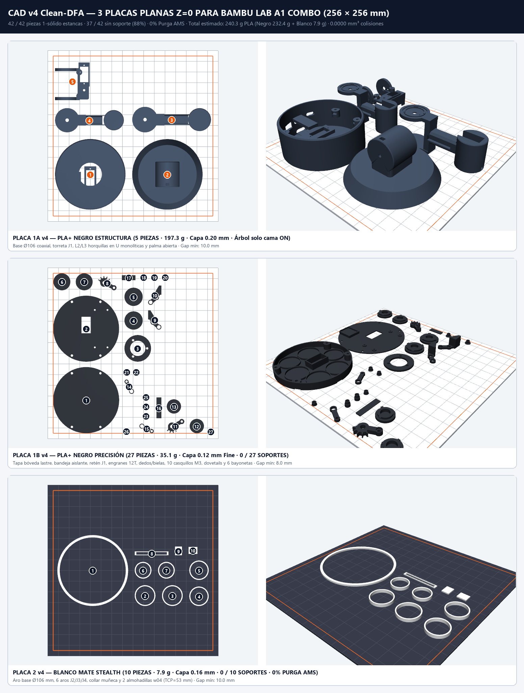

# Guía de Impresión 3D — Bambu Lab A1 Combo (`Mini-Pro 4-DOF B2 Stealth` · `CAD v4 Clean-DFA`)

> **Diseño `v4 Clean-DFA` (Ronda 2 Cerrada) — 0% Purga AMS y 0 Cautín:** Las **42 piezas estancas y de un solo sólido conectado (`42/42`, `len(split()) == 1`, `0.0000 mm³` colisiones B-Rep con tornillería, Nylocs y lastre)** están separadas en **3 placas `.3mf` (`256 × 256 mm`, `Z = 0.000 mm`)** listas para **Bambu Studio**. **37 de las 42 piezas (88%) se imprimen SIN soportes** y **no requieren insertos térmicos ni rodamientos `608ZZ`**.

---

## Orden Progresivo de Prototipado (OBLIGATORIO antes de imprimir el brazo entero)
Siguiendo la recomendación de ingeniería de la auditoría cruzada, valida los ajustes en **3 pasos rápidos** (`cad/exports/v4_clean_dfa/cupones_prueba/`):

1. **Cupón 1 — Ajustes, Bayoneta y Pivote (~18 min, `0.12 mm` o `0.16 mm`, 0 soportes):**
   * Archivo: [`cupon_1_ajustes_pivote_bayoneta.3mf`](../cad/exports/v4_clean_dfa/cupones_prueba/cupon_1_ajustes_pivote_bayoneta.3mf)
   * Valida con piezas físicas: calce del `MG90S`, tuercas `M3` y `M3 Nyloc` cautivas, deslizamiento de la tapa en cola de milano, giro libre del casquillo `11_separador_m3` bajo apriete `Nyloc`, y **10 ciclos de apertura/cierre de la tapa de bayoneta `32°`** en PLA Mate.
2. **Cupón 2 — Una Articulación Piloto `J2` Completa (~40 min, `0.20 mm`):**
   * Archivo: [`cupon_2_articulacion_piloto_j2.3mf`](../cad/exports/v4_clean_dfa/cupones_prueba/cupon_2_articulacion_piloto_j2.3mf)
   * Ensambla **1 solo `MG90S`** con herramientas reales: comprueba el acceso del desarmador por el barreno `Ø 5.2 mm` al tornillo del *horn*, aprieta los `2× M2` del servo, coloca el separador `M3` + `Nyloc` y confirma que la horquilla gira suave sin frenarse.
3. **Cupón 3 — Pinza Paralela Independiente MeArm Módulo `1.5` (~35 min, `0.12 mm`):**
   * Archivo: [`cupon_3_pinza_independiente_mearm15.3mf`](../cad/exports/v4_clean_dfa/cupones_prueba/cupon_3_pinza_independiente_mearm15.3mf)
   * Instala tu `SG90` y verifica apertura simétrica `0–30 mm`, paralelismo real de las mordazas, juego de los dientes módulo `1.5` (`12T`) y posición del centro de almohadilla en `53 mm`.

> **Ajuste paramétrico en 20 segundos:** Si tu filamento PLA Mate requiere `±0.05 mm` de ajuste, modifica `CLEARANCE_FIT` o `M3_NUT_AF` en [`cad/params.py`](../cad/params.py) y ejecuta `python cad/mini_pro_b2_stealth_v4.py ; python cad/generar_placas_bambu_a1_v4.py`.

---

> **Material Recomendado (`COMPARATIVA_MATERIALES_BAMBU_A1.md`):** Usa **PLA+ / PLA Pro Negro** (p. ej. Polymaker PolyLite PLA Pro o eSUN PLA+, acabado satinado sobrio) para las **Placas 1A y 1B** (`2×–5×` mayor resistencia al impacto en bayonetas, horquillas y dientes módulo `1.5` vs PLA Mate puro) y **PLA Blanco Mate** para los 10 acentos estéticos de la **Placa 2**.

## Resumen de las 3 Placas Definitivas (Bambu Studio · Boquilla `0.4 mm` · PEI `65 °C`)

| Orden | Archivo `.3mf` (Multi-Objeto) | Filamento Recomendado | Piezas | Altura Capa | Paredes / Relleno | Soportes | Masa Est. |
| :---: | :--- | :---: | :---: | :---: | :---: | :---: | :---: |
| **1** | [`placa_1a_negro_estructura_v4_020mm.3mf`](../cad/exports/v4_clean_dfa/placas_bambu_a1/placa_1a_negro_estructura_v4_020mm.3mf) | **PLA+ / PLA Pro Negro** | **5** | `0.20 mm Standard` | `4 paredes` · `20% Gyroid` | **Árbol (Auto · Solo cama) ON** | `~197.3 g` |
| **2** | [`placa_1b_negro_precision_v4_012mm.3mf`](../cad/exports/v4_clean_dfa/placas_bambu_a1/placa_1b_negro_precision_v4_012mm.3mf) | **PLA+ / PLA Pro Negro** | **27** | `0.12 mm Fine` | `4 paredes` · `25% Gyroid` | **OFF (`0 / 27`)** | `~35.1 g` |
| **3** | [`placa_2_blanco_mate_v4_016mm.3mf`](../cad/exports/v4_clean_dfa/placas_bambu_a1/placa_2_blanco_mate_v4_016mm.3mf) | **PLA Blanco Mate** | **10** | `0.16 mm Optimal` | `3 paredes` · `100%` | **OFF (`0 / 10`) · 0% AMS** | `~7.9 g` |

* **Total estimado del brazo completo:** **`~240.3 g` PLA** (`232.4 g` PLA+/PLA Pro Negro + `7.9 g` Blanco Mate). *(Si ya tienes PLA Negro Mate en mano, también es 100% compatible siguiendo el Cupón 1 de prueba de 10 aperturas de bayoneta).*
* **Respaldo individual en `Z = 0`:** Los **42 STLs ya orientados** están en [`stl_orientados_negro/`](../cad/exports/v4_clean_dfa/placas_bambu_a1/stl_orientados_negro/) y [`stl_orientados_blanco/`](../cad/exports/v4_clean_dfa/placas_bambu_a1/stl_orientados_blanco/).

---

## Detalle por Placa y Consejos Clave de Impresión

### Placa 1A — Negro Mate · Estructura (`5 piezas`, `0.20 mm`, Soporte Árbol Solo Cama ON)
* **Orientación de horquillas `L2` y `L3`:** Están acostadas sobre la cara `-Y` (`708 mm²` y `659 mm²` en PEI) para que las líneas de PLA corran **continuamente a lo largo de ambos brazos de la horquilla en U** (máxima rigidez frente a flexión) y para que los bolsillos de `MG90S J3`/`J4` miren hacia arriba (**0 soportes dentro de los bolsillos**).
* **Brim recomendado:** Activar **Brim exterior `5 mm`** solo en `04_torreta_j1_hombro_v4` (por objeto).
* **Distancia Z superior del soporte árbol:** `0.22 mm` para desprendimiento limpio con la mano.

### Placa 1B — Negro Mate · Precisión (`27 piezas`, `0.12 mm Fine`, **0 SOPORTES**)
* Incluye la tapa inferior con bóveda de lastre (`03_tapa_inferior_v4`, `7,226 mm²` planos en PEI con 6 huecos perimetrales `Ø 10.6 mm` para gomitas), la **bandeja electrónica aislante plana `03b_bandeja_electronica_v4`** (`7,282 mm²` en PEI), el **retén axial `04b_reten_axial_j1`**, los 2 sectores engranados `12T` módulo `1.5` (ambos boca abajo con avellanado `M3×16` arriba), los 2 dedos paralelos volteados boca abajo, las 2 bielas, los **3 separadores `M3` de brazo (`J2..J4`) + 7 casquillos lisos `M3` de la pinza (`11b..11e`)**, las 2 tapas deslizables en cola de milano y las **6 tapas Stealth de bayoneta `32°`** con su cara exterior apoyada sobre el PEI texturizado.
* **Tip Bambu Studio:** Orden de paredes `Interior/Exterior`, velocidad pared exterior `60 mm/s` para dientes módulo `1.5` y lengüetas de bayoneta impecables.

### Placa 2 — Blanco Mate · Acentos `B2 Stealth` (`10 piezas`, `0.16 mm`, **0 SOPORTES · 0% PURGA AMS**)
* Aro base `Ø 106 mm`, 6 aros articulares `J2/J3/J4`, collar de muñeca `w02` y 2 almohadillas de pinza `w04` (ya sin los micro-aros frágiles de `0.6 mm` de `v3`).
* Deja enfriar la cama PEI por debajo de `35 °C` antes de despegar el aro base `w01` para que conserve su planicidad perfecta.

---

## Notas de Ensamble Limpio (`Clean-DFA`)
1. **Pista anular `J1` (`Ø 88 mm`):** Antes de cerrar la base definitivamente, gira a mano `04_torreta` sobre `01_base_fija_v4` con `04b_reten_axial_j1` atornillado (`3× M3×8`) y comprueba el rozamiento real bajo ligera carga lateral; si sientes fricción seca PLA-PLA, aplica una tira fina de cinta PTFE (teflón) o una gota mínima de lubricante de silicón seco en el surco `Ø 88 mm`.
2. **Tuercas cautivas `M3` y `Nyloc`:** Inserta las `4×` tuercas hexagonales en los bolsillos interiores de la base y las `3× Nyloc` en los bolsillos de `J2/J3/J4` antes de montar los servos.
3. **Centrado obligatorio `CENTER`:** Antes de atornillar cualquier *horn*, enciende el robot, envía `CENTER` (`1500 µs` en `CH0..CH3`) y alinea los eslabones en su posición neutral.
