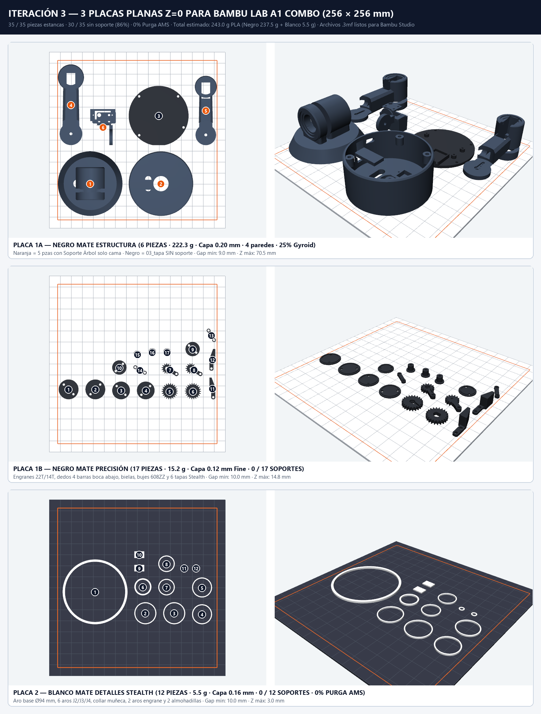

# Guía de Impresión 3D — Bambu Lab A1 Combo (`Mini-Pro 4-DOF B2 Stealth`)



> **Diseño 0% Purga AMS:** Las **35 piezas estancas (`35/35`)** están separadas por color y nivel de precisión en **3 placas nativas `.3mf` (`256 × 256 mm`, todas apoyadas en `Z = 0.000 mm`)** listas para abrir directamente en **Bambu Studio**. **30 de las 35 piezas (86%) se imprimen SIN soportes**, y ninguna cavidad de servo ni bolsillo de *horn* lleva soporte interno.

---

## Paso 0 (OBLIGATORIO): Calibración de Tolerancias en 20 Minutos
Antes de lanzar los ~243 g del brazo completo, imprime primero **solo** el kit de calibración en PLA Negro Mate (`0.20 mm`, `3 paredes`, `0 soportes`):
* **Archivo:** [`cad/exports/tolerance_test_kit_bambu_a1.stl`](../cad/exports/tolerance_test_kit_bambu_a1.stl) *(84 × 64 × 16 mm · ~14 g · ~20 min)*
* **Qué validar físicamente cuando te lleguen los componentes:**
  1. Rodamiento **`608ZZ-7`**: entra firme con presión de pulgar (sin romperse ni bailar).
  2. Servo **`MG90S`** y **`SG90`**: entran suaves por el acceso de orejas y engranan libremente los piñones de prueba.
  3. Botón **`KCD11-2P`**: entra a presión (*snap-fit*) limpio.
  4. Inserto térmico **`M3` (`AR2811`)**: el barreno de `Ø 4.10 mm` permite hundirlo recto con cautín a `210–220 °C`.
* **Si necesitas `±0.1 mm` de ajuste** en tu impresora/filamento: solo editas `CLEARANCE_FIT` o `BEARING_FIT` en [`cad/params.py`](../cad/params.py) y corres:
  ```powershell
  python cad/mini_pro_b2_stealth_v3.py
  python cad/generar_placas_bambu_a1.py
  ```
  *(Regenera automáticamente el `.step`, los 35 STLs y las 3 placas `.3mf` en ~20 segundos).*

---

## Resumen de las 3 Placas (Bambu Studio · Boquilla `0.4 mm` · Placa Textured PEI `65 °C`)

| Orden | Archivo `.3mf` (Multi-Objeto) | Filamento | Piezas | Altura Capa | Paredes / Relleno | Soportes | Masa Est. | Tiempo Est. A1 |
| :---: | :--- | :---: | :---: | :---: | :---: | :---: | :---: | :---: |
| **1** | [`placa_1a_negro_estructura_020mm.3mf`](../cad/exports/placas_bambu_a1/placa_1a_negro_estructura_020mm.3mf) | **PLA Negro Mate** | **6** | `0.20 mm Standard` | `4 paredes` · `25% Gyroid` | **Árbol (Auto · Solo cama)** en 5/6 | `~222 g` *(+~18 g árbol)* | `~4h 15m` |
| **2** | [`placa_1b_negro_precision_012mm.3mf`](../cad/exports/placas_bambu_a1/placa_1b_negro_precision_012mm.3mf) | **PLA Negro Mate** | **17** | `0.12 mm High Quality` | `4 paredes` · `30% Gyroid` | **DESACTIVADOS (`0 / 17`)** | `~15.2 g` | `~45 min` |
| **3** | [`placa_2_blanco_mate_016mm.3mf`](../cad/exports/placas_bambu_a1/placa_2_blanco_mate_016mm.3mf) | **PLA Blanco Mate** | **12** | `0.16 mm Optimal` | `3 paredes` · `100%` | **DESACTIVADOS (`0 / 12`)** | `~5.5 g` | `~14 min` |

> **Respaldo por pieza individual:** Si alguna vez quieres reimprimir solo una pieza (ej. un dedo o engrane), tienes los **35 STLs individuales ya orientados en `Z = 0`** en [`stl_orientados_negro/`](../cad/exports/placas_bambu_a1/stl_orientados_negro/) y [`stl_orientados_blanco/`](../cad/exports/placas_bambu_a1/stl_orientados_blanco/).

---

## Detalle Técnico por Placa (Orientaciones DFM y Configuración Exacta)

### Placa 1A — Negro Mate · Estructura (`6 piezas`, `0.20 mm Standard`)
* **Configuración global en Bambu Studio:**
  * **Boquilla:** `0.4 mm` · **Altura de capa:** `0.20 mm` · **Paredes (Wall loops):** `4` · **Capas Sup./Inf.:** `5 / 5`
  * **Relleno:** `25% Gyroid` *(máxima rigidez torsional en `L2`, `L3` y torreta)*
  * **Soportes:** `Activar soporte` → Tipo **`Árbol (auto)`** → Estilo `Árbol delgado (Tree Slim)` → **`Solo en placa de construcción` (On build plate only = ON)** → **Distancia Z superior: `0.22 mm`** *(se desprenden limpios con la mano)*.
  * **Adhesión (Brim):** En el menú *Por objeto*, activa **Brim exterior `5 mm`** solo en **`04_torreta_j1_hombro`** *(su eje en D apoya sobre `38 mm²` antes de que arranque el soporte árbol bajo la corona)*.

| # | Pieza | Tamaño en Placa (mm) | Apoyo PEI | Soporte | Por qué esta orientación |
| :-: | :--- | :---: | :---: | :---: | :--- |
| 1 | `04_torreta_j1_hombro` | `94.0 × 94.0 × 70.5` | `38 mm²` *(+Brim 5)* | **Árbol (solo cama)** | Vertical: eje en D concéntrico y circular sin escalonamiento. |
| 2 | `01_base_fija_hueca` | `93.9 × 93.9 × 44.0` | `5,965 mm²` | **Árbol (solo cama)** | **Boca abajo:** techo Ø91 mm y asiento `608ZZ` planos en PEI; insertos `AR2811` hacia arriba. |
| 3 | `03_tapa_inferior_electronica` | `87.2 × 86.4 × 8.8` | `5,495 mm²` | **Ninguno** | Cara plana en PEI; 4 postes `PCA9685` y cuna `XIAO` suben limpios. |
| 4 | `05_eslabon_l2_codo` | `38.0 × 117.5 × 48.0` | `312 mm²` | **Árbol (solo cama)** | Sobre cara `-Y`: fibra continua en la viga; bahía `MG90S J3` y bolsillo *horn* miran hacia arriba (`0` soporte interno). |
| 5 | `06_antebrazo_l3_muneca` | `32.0 × 101.0 × 48.0` | `235 mm²` | **Árbol (solo cama)** | Sobre cara `-Y`: fibra continua en la viga; bahía `MG90S J4` y bolsillo *horn* miran hacia arriba (`0` soporte interno). |
| 6 | `07_palma_pinza_sg90` | `37.5 × 52.5 × 36.6` | `174 mm²` | **Árbol (solo cama)** | Base plana del carenado `SG90` en PEI; cavidad `SG90` vertical y 4 pivotes M3 perfectamente circulares. |

---

### Placa 1B — Negro Mate · Precisión (`17 piezas`, `0.12 mm High Quality`, **0 SOPORTES**)
* **Por qué separarla a `0.12 mm`:** Los engranes módulo `1.0` (`22T` y `14T`), la chaveta en D de `1.1 mm`, los bolsillos de *horn* (`1.9 mm`) y los bujes `608ZZ` (`Ø 7.86 mm`) salen **ultra suaves y sin juego**, sin arriesgar 4 horas de impresión estructural.
* **Configuración en Bambu Studio:**
  * **Altura de capa:** `0.12 mm High Quality` · **Paredes:** `4` · **Relleno:** `30% Gyroid` · **Soportes:** **`OFF`**
  * **Velocidad pared exterior:** bajar a `60 mm/s` *(dientes de engrane impecables)* · **Orden de paredes:** `Interior/Exterior`.
  * **Opcional:** Brim `3 mm` solo en los 3 bujes (`11_buje_608zz_j2/j3/j4`) si tu placa PEI tiene poco agarre.
* **Detalle clave:** Los 2 dedos (`10_dedo_pinza_izq/der`), el piñón (`02_pinon_base_22t`) y el engrane-brazo izquierdo (`08_engrane_brazo_izq`) ya vienen volteados **boca abajo** para imprimir **0% soportes** y dejar los bolsillos de *horn* hacia arriba; las **6 tapas Stealth** vienen con su cara visible hacia la placa PEI texturizada para un acabado mate comercial uniforme.

---

### Placa 2 — Blanco Mate · Detalles Stealth (`12 piezas`, `0.16 mm Optimal`, **0 SOPORTES · 0% PURGA AMS**)
* **Configuración en Bambu Studio:**
  * **Altura de capa:** `0.16 mm Optimal` · **Paredes:** `3` · **Soportes:** **`OFF`** · **Torre de purga:** **`OFF`**
  * Selecciona el carrete **PLA Blanco Mate** en tu AMS Lite (0 cambios de color durante la impresión).
* **Nota sobre `w03_aro_engrane_0/1` (`Ø 7.2 × 0.6 mm`):** Son dos micro-aros decorativos súper finos (`27 mm²`). Deja enfriar la placa PEI a `< 35 °C` antes de despegarlos con cuidado para que no se doblen.

---

## Consejos de Post-Procesado e Insertos Térmicos (`AR2811`)
1. **Desprende los soportes árbol de la Placa 1A** con pinzas de punta fina; verifica que el ducto interno de cables (`10 × 8 mm`) de `L2` y `L3` quede libre pasando un cable Dupont 3-pin de prueba.
2. **Insertos de latón `M3` (`AR2811`, `Ø 4.5 × 3.0 mm`):**
   * Temperatura del cautín: **`210 – 220 °C`** (no exceder `230 °C` en PLA Mate).
   * Empuja verticalmente **sin presión lateral** hasta dejar el inserto a ras (`0.0 mm`) con la cara del plástico; espera 10 segundos y presiona brevemente con una regla metálica plana para nivelarlo perfecto.
   * Ubicaciones: `4×` en la base (`01_base_fija_hueca`), `1×` en el disco motriz de `05_eslabon_l2_codo`, `1×` en `06_antebrazo_l3_muneca` y `1×` en `07_palma_pinza_sg90` *(los sobrantes quedan de repuesto)*.
3. **Asentado suave de engranes (`22T:22T` y `14T:14T`):** Hazlos girar a mano 20–30 ciclos antes de conectar los servos para pulir cualquier micro-rebaba de costura (*Z-seam*); opcionalmente una gota mínima de grasa de silicón o PTFE seco.
