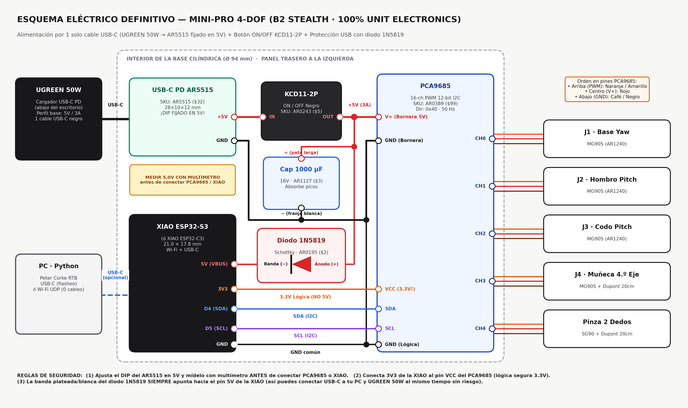

# Guía de Cableado Eléctrico — Mini-Pro 4-DOF (`B2 Stealth`)

---

## 1. Tabla Maestra de Conexiones (100% Carrito UNIT Electronics)

### A) Etapa de Potencia (`5V 3A` — 1 solo cable USB-C desde tu UGREEN 50W)
| Origen | Destino | Cable / Polaridad | Notas clave |
| :--- | :--- | :--- | :--- |
| **Cargador UGREEN 50W** | **Módulo USB-C PD `AR5515`** | 1 cable USB-C a USB-C negro | **Fijar micro-switches DIP del `AR5515` en `5V`**. |
| **`AR5515` `+5V` (bornera)** | **`KCD11-2P` pin 1 (`IN`)** | Rojo (calibre 20–22 AWG) | Corta la alimentación general desde el botón trasero. |
| **`KCD11-2P` pin 2 (`OUT`)** | **`PCA9685` bornera verde `V+`** | Rojo | Alimenta los 5 servos (`CH0`–`CH4`). |
| **`PCA9685` bornera `V+` / `GND`** | **Capacitor `1000 µF 16V` (`AR1127`)** | Pata larga `+` → `V+` · Franja blanca `−` → `GND` | Va directo en la bornera verde; absorbe picos de corriente. |
| **`KCD11-2P` pin 2 (`OUT`)** | **Diodo `1N5819` Ánodo `+`** → **Cátodo (banda)** → **`XIAO ESP32-S3` pin `5V`** | Rojo + diodo en serie | **La banda blanca/plateada SIEMPRE apunta hacia la `XIAO`.** Permite conectar USB-C a tu laptop y el UGREEN 50W al mismo tiempo sin riesgo de retorno. |
| **`AR5515` `GND` (bornera)** | **`PCA9685` `GND` + `XIAO` `GND`** | Negro (estrella común) | Todas las tierras deben estar unidas entre sí. |

### B) Bus Lógico I2C Seguro (`3.3V` — 4 cables Dupont H–H `AR0097`)
| Pin `XIAO ESP32-S3` (ó `C3`) | Pin `PCA9685` (costado izquierdo) | Color sugerido | Advertencia |
| :---: | :---: | :---: | :--- |
| **`3V3`** | **`VCC`** | Naranja | **NUNCA conectes `5V` a `VCC`** (dañaría los pines I2C de 3.3V del ESP32). |
| **`D4` (`SDA`)** | **`SDA`** | Azul | En S3 es `GPIO5`, en C3 es `GPIO6` (firmware usa `SDA` automático). |
| **`D5` (`SCL`)** | **`SCL`** | Morado | En S3 es `GPIO6`, en C3 es `GPIO7` (firmware usa `SCL` automático). |
| **`GND`** | **`GND`** | Negro | Tierra lógica común. |

### C) Mapa de Canales de Servos en `PCA9685` (`50 Hz`)
> **Orden de colores en los pines del `PCA9685`:** **Arriba (`PWM`) = Naranja/Amarillo** · **Centro (`V+`) = Rojo** · **Abajo (`GND`) = Café/Negro**.

| Canal | Articulación | Servo | Rango lógico | Extensión |
| :---: | :--- | :--- | :---: | :--- |
| **`CH0`** | **J1 · Base Yaw** | `MG90S` (`AR1240`) | `[-90°, +90°]` | Directo |
| **`CH1`** | **J2 · Hombro Pitch** | `MG90S` (`AR1240`) | `[+15°, +165°]` | Directo |
| **`CH2`** | **J3 · Codo Pitch** | `MG90S` (`AR1240`) | `[-135°, +45°]` | Directo |
| **`CH3`** | **J4 · Muñeca 4.º Eje** | `MG90S` (`AR1240`) | `[-90°, +90°]` | 3 hilos Dupont M–H 20 cm (`AR0003`) |
| **`CH4`** | **Pinza Paralela 2 Dedos** | `SG90` *(ya disponible)* | `0 – 30 mm` | 3 hilos Dupont M–H 20 cm (`AR0003`) |

---

## 2. Protocolo de Primer Encendido Seguro (Lista de Verificación en Banco)

1. **Prueba aislada del `AR5515` (CRÍTICO):** Sin conectar nada a la salida del `AR5515`, pon su interruptor DIP en **5V**, enchufa tu cargador **UGREEN 50W** y **mide con multímetro** entre `+` y `-`: debe marcar **`4.95 – 5.15 V`**. *(Nunca saltes este paso: si el DIP estuviera por error en 9V/12V quemaría los servos y el `PCA9685`).*
2. **Verifica polaridad del capacitor y del diodo:**
   * Franja blanca (`−`) del capacitor `1000 µF` en **`GND`**.
   * Banda plateada (`−`) del diodo `1N5819` apuntando hacia el pin **`5V`** de la `XIAO ESP32-S3`.
3. **Prueba I2C sin servos:** Enciende el botón `KCD11-2P` (o conecta USB-C a tu PC) y abre el Monitor Serial a `115200 baud` → el firmware debe imprimir `[OK] PCA9685 detectado en 0x40`.
4. **Centrado de servos ANTES de atornillar los *horns*:** Conecta los `4× MG90S` sueltos en `CH0..CH3`, envía `CENTER` por Serial (o pulsa **"Centrar 90°"** en la Web UI) → todos giran a su centro mecánico exacto (`1500 µs`). Solo entonces atornillas los *horns* y ensamblarás las articulaciones.
